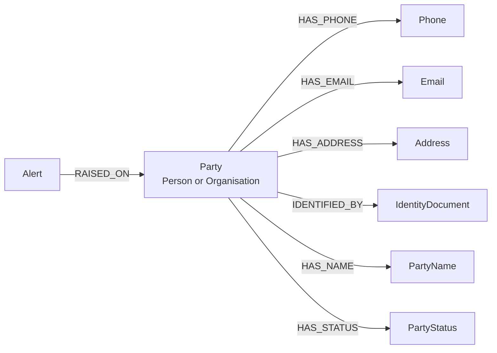

# Network Search: Party and PII Modeling Guideline

| | |
|---|---|
| **Status** | Draft for review |
| **Date** | 2026-10-13 |
| **Applies to** | Everyone who models, loads or queries party data in the Network Search graph: names, identity documents, addresses, contact details, statuses, residency, tax compliance and risk scores |
| **Read with** | [Graph Modeling Guideline](graph-modeling-guideline.md), [Data Contract Driven Delivery Guideline](../05-data/data-contract-guideline.md), [Infinigraph Fraud Platform architecture](../architecture/Infinigraph%20Fraud%20Platform.html), `docs/10-security-governance/pii-handling.md` |

## 1. Purpose

Party data is where most of the personal information in the graph lives, and almost all of it changes over time. A party can change name, move house, hold several valid business numbers at once and pass through many statuses. This guideline sets out how each piece is modeled so that history is kept, sharing between parties is traversable, and personal information is held no more widely than it needs to be.

It also covers one question the Graph Modeling Guideline does not: what changes if the graph moves from a single Neo4j database to Infinigraph, and which of those changes are worth making now.

The Graph Modeling Guideline applies in full. This document adds to it and never overrides it. Where the recommendations here depart from one of its rules, the departure is listed in section 11 and needs an ADR before anyone builds on it.

**Must** and **should** carry the same meaning as in the Graph Modeling Guideline.

## 2. Three kinds of party data

One test decides where a piece of party data goes: **can two parties share the value?**

| Kind | Test | Where it lives | Examples |
|---|---|---|---|
| Shared identifier | Two parties can hold the same value, and that is a fraud signal | Its own node, linked from each party | Phone, email, address, identity document |
| Per-party history | The value belongs to one party and changes over time | A node owned by that one party | Former names, status periods |
| Current value | Queries filter on or display the value as it is today | A property on `Party` | Current name, gender, risk score |

A name is not a shared identifier. A shared `Name` node for "John Smith" links thousands of unrelated people and is a supernode by construction (Graph Modeling Guideline, section 8).

## 3. The model



`Phone`, `Email`, `Address` and `IdentityDocument` are shared between parties. `PartyName` and `PartyStatus` each belong to exactly one party. Every relationship points out from `Party`; section 8 explains why that direction matters.

### 3.1 Element by element

| # | Data | Model | Time variance | Held as |
|---|---|---|---|---|
| 1 | Internal identifiers | `partyId` (business key) and `crmId` on `Party` | Never changes | Clear |
| 2 | Name | Current name on `Party` (`displayName`, `givenName`, `familyName`); each former name is a `PartyName` node | One current; history in `PartyName` | Clear |
| 3 | Gender | `gender` on `Party` | One current; history is not loaded unless a question needs it | Clear |
| 4 | Identification | Shared `IdentityDocument` node; `documentType` is `DRIVER_LICENCE`, `PASSPORT`, `ABN`, `ACN` or `TAX_NUMBER` | Several can be valid at once (a party with three ABNs has three open relationships) | Hashed (section 6) |
| 5 | Address | Shared `Address` node; `usage` on the relationship is `RESIDENTIAL`, `POSTAL` or `BUSINESS` | Several current, one per usage or more | Clear |
| 6 | Contact | Shared `Phone` and `Email` nodes; `usage` on the relationship | Several current | Clear |
| 7 | Tax compliance status | `PartyStatus` with `domain: 'TAX_COMPLIANCE'` | Several can be open at once | Restricted |
| 8 | Role and status | `PartyStatus` with `domain` of `PERSONAL`, `FINANCIAL`, `VALUE`, `ACTIVITY` or `AML` | Several can be open at once | AML restricted |
| 9 | Residency and citizenship | `PartyStatus` with `domain` of `RESIDENCY`, `CITIZENSHIP` or `TAX_RESIDENCY`, and a `country` code | Several can be open at once | Clear |
| 10 | Risk score | `riskScore`, `riskBand`, `riskModelVersion`, `riskScoredAt` on `Party` | Current only; history goes to the warehouse | Restricted |

A US citizen living in Australia is three open statuses on one party: `CITIZENSHIP` with `country: 'US'`, `RESIDENCY` with `country: 'AU'`, and `TAX_COMPLIANCE` with `code: 'FATCA_US_PERSON'`.

### 3.2 Nodes this guideline adds

| Label | What it represents | Business key | Notes |
|---|---|---|---|
| `PartyName` | A name a party has used | `nameKey` | Belongs to one party. Feeds `Party.aliases` for name search |
| `PartyStatus` | One status a party holds or held | `statusKey` | Belongs to one party. Carries `domain`, `code` and, where the status is about a jurisdiction, `country` |

Country stays a property. It is a category, and the Graph Modeling Guideline rules out category nodes (section 4).

### 3.3 Relationships

| Pattern | Key properties | Change from the Graph Modeling Guideline |
|---|---|---|
| `(:Party)-[:HAS_PHONE]->(:Phone)` | `usage`, `validFrom`, `validTo` | None |
| `(:Party)-[:HAS_EMAIL]->(:Email)` | `usage`, `validFrom`, `validTo` | None |
| `(:Party)-[:HAS_ADDRESS]->(:Address)` | `usage`, `validFrom`, `validTo` | None |
| `(:Party)-[:IDENTIFIED_BY]->(:IdentityDocument)` | `verifiedAt`, `validFrom`, `validTo` | Adds validity, because a party can stop holding a document |
| `(:Party)-[:HAS_NAME]->(:PartyName)` | `validFrom`, `validTo` | New |
| `(:Party)-[:HAS_STATUS]->(:PartyStatus)` | `validFrom`, `validTo` | New |

A document's expiry date is a fact about the document, so `expiryDate` is a property on `IdentityDocument`, not on the relationship.

### 3.4 Alerts are not statuses

An alert has its own ID and lifecycle and points at parties, accounts and transactions. It is the `Alert` node already defined in the Graph Modeling Guideline. Only the standing that results from it (for example an AML status) is a `PartyStatus`.

## 4. Time variance

The rules in section 7.1 of the Graph Modeling Guideline apply. For party data they work out as follows.

- Every relationship in 3.3 **must** carry `validFrom`. An open one has no `validTo`.
- A point-in-time query tests both ends: `r.validFrom <= $asOf AND (r.validTo IS NULL OR r.validTo > $asOf)`.
- A party who returns to an old address gets a second relationship to the same `Address` node.
- **"Only one current" is a load rule.** Neo4j cannot enforce that a party has one open name. The CDC load **must** close the old period in the same transaction that opens the new one, and the data contract **must** state the rule as a quality check.
- **Current values on `Party` are copies.** The load that opens a new `HAS_NAME` period also sets `displayName`. Nothing else writes those properties.
- **Keep only the history that connects.** Former addresses, phones, emails, documents and names stay in the graph, because a past link between two parties is evidence. Risk score history and the history of non-AML statuses go to the warehouse, keyed by `partyId`.

If investigators need "what did we believe on date X" for audit, as well as "what was true on date X", every relationship also needs a recorded-at timestamp. This is open decision 3 in section 12; it is painful to add after Day 0.

## 5. Address identity

`addressId` **must** come from address standardisation, never from free text. In Australia that is possible for nearly every address.

- **G-NAF** (the Geocoded National Address File, open data published by Geoscape) gives each physical address a persistent ID.
- **DPID** (Australia Post's Delivery Point Identifier) covers delivery points, including PO boxes, which G-NAF covers poorly.
- **Matching is not complete.** The ID is obtained by passing the raw address through a matching service. New estates, rural addresses and poor-quality input will not always match.
- **Overseas addresses have no equivalent.**

The key is therefore our own: `addressId` is the business key, `gnafPid` and `dpid` are optional properties, and an address with neither is keyed on a hash of its normalised text. Overseas addresses carry `isOverseas: true` and a `country` code.

## 6. Personal information

The rules in section 10 of the Graph Modeling Guideline and in `pii-handling.md` apply. The "Held as" column in 3.1 is this guideline's proposal for each element; the final classification is open decision 1.

- **Identity document numbers are hashed.** `documentKey` is a keyed hash of document type, issuer and number. Matching needs equality, not the value.
- **A tax number is an `IdentityDocument`, never a property on a relationship or on `Party`.** A node with its own label can be restricted as a unit; a property scattered across relationships cannot.
- **AML and tax compliance statuses are restricted.** Showing a party's AML standing to staff who have no need for it risks tipping off. Access is limited to investigation roles.
- **Minimise before loading.** A status domain that no question in section 2 of the Graph Modeling Guideline uses is not loaded.

Whether Australian tax file numbers can be loaded at all, even hashed, is open decision 2. Their use is restricted by law to specific purposes, and matching parties on them for fraud detection may not be one.

## 7. Single graph or Infinigraph

The architecture document concludes that Infinigraph is not needed yet: the whole graph fits one instance today. The model should still be one that survives the move, because the parts that differ are expensive to change once data is loaded.

### 7.1 What is different on Infinigraph

Infinigraph splits a database in two. One **graph shard** holds every node, relationship, label and relationship type. Several **property shards** hold the property values. Traversal runs on the graph shard; properties are fetched from the property shards, ideally once, at the end of the query.

Three consequences follow:

- **Labels and relationship types are free to filter on. Properties are not.** A property tested in the middle of a pattern forces a fetch for every candidate before most are discarded.
- **A node's properties and its outgoing relationships' properties sit on the same shard.** Every relationship in 3.3 points out from `Party`, so everything about one party comes back in one fetch. A shared address with thousands of residents causes no imbalance, because each relationship's properties live with its party.
- **`MERGE` and uniqueness constraints are slow**, because each check crosses shards.

### 7.2 What changes in the model

| Area | Single graph | Infinigraph | Adopt now? |
|---|---|---|---|
| Current and ended periods | One relationship type; test `validTo` | Two types: `HAS_ADDRESS` for open periods, `HAD_ADDRESS` for ended ones | **Yes** (section 7.3) |
| Statuses that traversals filter on | `riskBand` and status properties on `Party` | Labels on `Party` for the few that are selective and slow-changing | No |
| Document and phone sub-types | `documentType`, `phoneType` properties | Sub-type labels such as `Passport`, `Mobile` | No |
| High-degree nodes | `isHighDegree` property | A `HighDegree` label | No |
| Writes | `MERGE` on a constrained business key | Key resolved in Orchestra, then `MATCH` / `CREATE`; plain index, no uniqueness constraint | No, but see section 9 |
| Restricting personal information | Property-level access control | Not available; restrict by label | No, but section 6 already models for it |

The rows marked "No" are cheap to apply at migration: each is a backfill that adds labels or drops constraints. They also break rules in the Graph Modeling Guideline that are right for a single graph, so they wait until a move is decided.

### 7.3 Splitting current from ended relationships

This is the one change worth making before Day 0.

- An open period uses the `HAS_` type and has no `validTo`: `HAS_ADDRESS`, `HAS_PHONE`, `HAS_EMAIL`, `HAS_NAME`, `HAS_STATUS`, `IDENTIFIED_BY`.
- An ended period uses the matching past type and always has `validTo`: `HAD_ADDRESS`, `HAD_PHONE`, `HAD_EMAIL`, `HAD_NAME`, `HAD_STATUS`, `WAS_IDENTIFIED_BY`.
- Closing a period deletes the open relationship and creates the ended one, with the same properties plus `validTo`, in one transaction. No history is lost.

Why now: nearly every traversal wants current links only, and a type lets it skip ended ones on either architecture. Retrofitting the split later means rewriting every time-variant relationship in the graph.

What it costs: closing a period becomes a delete and a create instead of a property update, queries over all history name two types, and an out-of-order event that reopens a closed period needs handling in the load.

### 7.4 Properties on relationships are still good practice

A relationship property that is only returned costs nothing extra on Infinigraph. Do not turn every property into a type. Promote a property to a type or label only when all three hold:

1. Traversals filter on it, not just return it.
2. It has a handful of values at most.
3. It changes rarely. Changing a type or label is a write to the graph shard; updating a property is not.

| Property | Verdict | Reason |
|---|---|---|
| Current or ended | Type | Passes all three |
| `validFrom`, `validTo` | Property | Dates have too many values to be types |
| `usage` | Property | Shared-address queries want any usage |
| `verifiedAt`, provenance | Property | Returned, not filtered on |

A relationship has one type, so each extra dimension multiplies the list. Adding `usage` to the type gives `HAS_RESIDENTIAL_ADDRESS`, `HAD_RESIDENTIAL_ADDRESS`, `HAS_POSTAL_ADDRESS` and so on: six types where there were two, and every new usage value becomes a schema change. If a second dimension must be structural, make it a label on the target node. Labels stack; types do not.

## 8. Date filters in quantified paths

Some investigation queries follow shared identifiers across several hops and filter each hop on `validFrom`. On a single graph this is fine: the filter prunes as the path expands.

```cypher
MATCH (a:Party {partyId: $partyId})
      (()-[r1:HAS_ADDRESS WHERE r1.validFrom >= $since]->
         (x:Address WHERE x.isHighDegree IS NULL)
         <-[r2:HAS_ADDRESS WHERE r2.validFrom >= $since]-(:Party)){1,3}
      (b:Party)
RETURN DISTINCT b.partyId
```

On Infinigraph this is the one shape where a relationship property is expensive, and a date cannot become a type. The architecture document records the slowdown for filtered variable-length paths; how much it costs for quantified paths is not published and **must** be measured with `PROFILE` on a real cluster. The right design depends on what the date filter means.

| The filter means | Design | Limits |
|---|---|---|
| "As of now" | Traverse the `HAS_` types. No property is read | None |
| A fixed recency window, such as "changed in the last 90 days" | A scheduled job maintains a marker for the window: a label on `Party`, or an extra relationship type alongside `HAS_ADDRESS` | Only for a small, fixed set of windows. The job must also remove markers as they age out |
| Any date, or "at the same time" | Derive a party-to-party relationship at write time (section 8.1) | More relationships, one more pipeline step |

### 8.1 Derived overlap relationship

When the question is "which parties shared an identifier during the same period", compute the overlap once and store it:

```
(:Party)-[:SHARES_IDENTIFIER_WITH {identifierType, overlapFrom, overlapTo, derivedBy, derivedAt}]->(:Party)
```

The quantified path then runs over `SHARES_IDENTIFIER_WITH` alone. The relationship exists only where the periods overlap, so no date is read during traversal. It halves the hops and never passes through a high-degree identifier, which helps on a single graph too.

- It is derived data and follows section 9 of the Graph Modeling Guideline: `derivedBy`, `derivedAt`, no `sourceSystem`, rebuildable from the sourced relationships.
- It **must not** be derived through high-degree identifiers. The number of relationships grows with the square of the parties sharing the identifier.

### 8.2 Traverse first, filter after

Where no derived relationship exists, keep the pattern free of property tests and filter the surviving paths:

```cypher
MATCH p = (a:Party {partyId: $partyId})
          (()-[:HAS_ADDRESS|HAD_ADDRESS]->(:Address&!HighDegree)
             <-[:HAS_ADDRESS|HAD_ADDRESS]-(:Party)){1,3}
WITH p LIMIT 5000
WHERE all(r IN relationships(p) WHERE r.validFrom >= $since)
RETURN p
```

Nothing prunes during expansion, so this holds up only with a low hop bound and high-degree nodes excluded. The limit is applied before the date filter and can drop valid paths without any warning; a query that returns exactly the limit **must** be treated as incomplete.

## 9. Write path

On a single graph, section 7.3 of the Graph Modeling Guideline applies unchanged: uniqueness constraint on the business key, `MERGE` on the key alone, guard on `sourceUpdatedAt`.

Shared identifier nodes are get-or-create by nature, which is the `MERGE` shape Infinigraph handles badly. Two habits now keep a later move to a constraint drop and not a pipeline rewrite:

- **Keys are deterministic and computed before the write.** G-NAF PID or address hash, E.164 phone number, lower-cased email, hashed document key. The shared normalisation library already does this.
- **Orchestra should know whether a key is new without asking the graph.** A registry of loaded keys upstream is what lets `MERGE` be replaced with `MATCH` / `CREATE` later.

## 10. What party history does to sizing

The architecture document estimates that base entities carry about 460 GB of the 656 GB of property data, and that trimming them defers Infinigraph further than shortening the transaction window. Time-variant party data is where that width comes from. Every status domain, former name and provenance property loaded here is multiplied by every party and every period.

The rule in section 4 (keep only the history that connects) is therefore a sizing decision as well as a modeling one. Its cost is that a point-in-time question about scores or non-AML statuses needs a second lookup in the warehouse.

## 11. Departures from the Graph Modeling Guideline

Each needs an ADR in `docs/12-decisions/adr/`. Until an ADR is accepted, the Graph Modeling Guideline stands and the model is built without the departure.

| # | Departure | Rule affected | When |
|---|---|---|---|
| D1 | `HAS_` / `HAD_` split for time-variant party relationships (section 7.3) | 7.1: "When a fact ends, set `validTo`. Don't delete the relationship." History is still kept, but the open relationship is replaced | Before Day 0 |
| D2 | New labels `PartyName` and `PartyStatus`; validity added to `IDENTIFIED_BY` | Section 15: new labels and types need an ADR | Before Day 0 |
| D3 | Status and risk-band labels on `Party` | Section 4: states are properties; section 9: only three marker labels | Only on a move to Infinigraph |
| D4 | `HighDegree` label in place of `isHighDegree` | Section 8 | Only on a move to Infinigraph |
| D5 | No uniqueness constraints; `MATCH` / `CREATE` in place of `MERGE` | Sections 6, 7.3 and 11 | Only on a move to Infinigraph |
| D6 | Personal information restricted by label, not by property | Section 10: property-level access control | Only on a move to Infinigraph |

The ADR for D1 should also decide whether the split extends to `HOLDS`, `IS_SIGNATORY_OF`, `ENROLLED_IN` and the other time-variant relationships outside party data.

## 12. Open decisions

| # | Decision | Why it matters | Proposed owner |
|---|---|---|---|
| 1 | Classification of each element in 3.1, and whether ABN and ACN (public register values) are held in clear | Access control design; investigators may need to read business numbers | Security and privacy |
| 2 | Whether tax file numbers may be loaded, even hashed | Legal restriction on their use | Privacy, legal |
| 3 | Whether relationships carry a recorded-at timestamp as well as validity | Audit questions; cannot be backfilled accurately | Data architecture, fraud operations |
| 4 | Which status domains are loaded, and which keep history in the graph | Property volume (section 10) | Fraud operations, data architecture |
| 5 | Which recency windows, if any, get a maintained marker | Section 8; each is a scheduled job | Fraud operations |
| 6 | Which identifier types get `SHARES_IDENTIFIER_WITH`, and the degree cap for deriving it | Relationship volume | Graph engineering |
| 7 | Address matching service, and the expected unmatched rate | Quality of `addressId`, and so of every shared-address result | Data engineering |
| 8 | Cost of property filters inside quantified paths on Infinigraph | Decides how much of section 8 is needed | Graph engineering, with Neo4j |

## 13. Review checklist

In addition to the checklist in the Graph Modeling Guideline:

- [ ] Each new piece of party data is classified as shared identifier, per-party history or current value.
- [ ] Nothing that identifies one party only has become a shared node.
- [ ] The load closes the old period in the same transaction that opens the new one.
- [ ] Current values on `Party` are written only by the load that opens the period.
- [ ] Identity document numbers are hashed, and no tax number is stored as a property.
- [ ] History that does not connect parties goes to the warehouse.
- [ ] Every relationship points out from `Party`.
- [ ] No query filters on a relationship property inside a quantified path without a note on how it behaves on Infinigraph.
