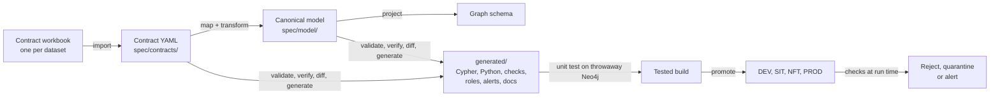

# Network Search: Data Contract Driven Delivery Guideline

| | |
|---|---|
| **Status** | Draft for review |
| **Date** | 2026-10-11 |
| **Applies to** | Everyone who brings data into the Network Search graph or changes how it is loaded: source owners, analysts, data engineers, graph engineers, data stewards, Hume Orchestra developers, testers and release managers |
| **Read with** | [Graph Modeling Guideline](../04-modeling-guidelines/graph-modeling-guideline.md), [repo-structure.txt](../deployment/repo-structure.txt), sample contracts for the [Day 0 extract](../data-contracts/customer-day0.contract.xlsx) and the [CDC topic](../data-contracts/customer-cdc.contract.xlsx), [sample canonical model](../data-contracts/canonical-model-sample.yaml) |

## 1. Purpose

Network Search loads the same business facts from several places: a one-off extract to populate the graph, and a stream of change events to keep it current. Written by hand, each loader, quality check, access rule and alert is a separate piece of work that drifts from the others.

This guideline sets out a different way of working. We describe each source dataset once, in a **data contract**, and map it to one **canonical model**. The graph is projected from that model. Everything else is generated and delivered through one pipeline.

It covers what a contract contains, where it lives, how it is written and reviewed, what is generated from it, how a change reaches production, and how the contract is enforced when data is loaded. How the graph itself is shaped is in the Graph Modeling Guideline.

Where this guideline says **must**, a deviation needs an ADR. Where it says **should**, deviate if you have a reason and note it in the pull request.

The generator described here, `contractctl`, is not built yet. Section 16 gives the order in which it will be built and section 18 lists the decisions still open. Rules that depend on them are marked *(open)*.

## 2. The method on one page



Diagrams: [the end-to-end flow](data-contract-flow.drawio), [the contract template](data-contract-template.drawio) and [the pipeline architecture](cicd-architecture.drawio).

Eight principles hold the method together:

1. **Define once.** A dataset's schema, quality rules and service levels are stated in its contract and nowhere else.
2. **Three layers.** A source contract maps to the canonical model; the graph is projected from the canonical model. Sources never map straight to the graph.
3. **Transform once, at the source edge.** All normalising, standardising and code translation happens between source and canonical model. Canonical to graph is structural only.
4. **Generate, don't hand-write.** Anything that can be derived from the contracts and the canonical model is generated. Hand-written code is for logic that cannot be declared.
5. **Contract what you consume.** One contract per dataset Network Search actually reads, agreed with the team that produces it.
6. **One canonical model, every path.** The Day 0 load and the event stream arrive at the same canonical records, so they write the same graph.
7. **Enforce at run time.** The pipeline proves the specification is coherent. Only checks at load time prove the source is honouring it.
8. **Git is the record.** Every change is a reviewed pull request, and every environment runs a build made from a known commit.

## 3. Terms

| Term | Meaning |
|---|---|
| **Dataset** | One physical thing we read: a parquet extract or a Kafka topic. |
| **Data contract** | The agreement for one dataset: location, schema, quality rules, service levels, ownership, how it expresses change, and its mapping to the canonical model. |
| **Paired contracts** | Two contracts for the same source table, typically its Day 0 extract and its CDC topic. |
| **Canonical model** | The single definition of entities, attributes, relationships, types, allowed values and classification, using glossary terms. |
| **Graph projection** | Annotations on the canonical model that say what becomes a node, a relationship or a property, and how history is kept. |
| **Mapping** | The part of a contract that takes each source field to a canonical attribute, with its transform. |
| **Transform** | A named, tested function that turns a source value into a canonical value. |
| **Canonical record** | The in-flight result of applying a contract's mapping to one source record. Not stored. |
| **Product contract** | A contract for data the graph produces, such as risk scores, alerts and cases. |
| **Spec** | Everything hand-authored under `spec/`. |
| **Generated artefact** | Any file under `generated/`. |

## 4. The three layers

```
source contract ──(map + transform)──▶ canonical model ──(project)──▶ graph
   per dataset        in the contract      defined once     defined once
```

| Layer | Holds | Transformation |
|---|---|---|
| Source contract | Physical schema, location, quality, service levels, and each field's canonical attribute | All of it |
| Canonical model | Entities, attributes, relationships, types, allowed values, classification | None; it is the target vocabulary |
| Graph projection | Which entity is a node, which attribute is a key, a property or an identifier node, indexes, temporal policy | Structural only |

- The canonical model and the graph projection are **one model**, authored together in `spec/model/`. Canonical names are glossary terms and are also the graph property names, so the projection renames nothing.
- The canonical model **must** contain only what the graph's questions need (Graph Modeling Guideline, section 2). It is not an enterprise data model.
- Canonical records are **not stored**. They are the shape of the data between transform and load. Persisting them would create another store of personal information with its own retention and service level *(open)*.
- Every source's output is validated against the canonical model's types and allowed values before it reaches the graph. This check is generated; nobody writes it per source.
- Rules that span sources live at the canonical layer: precedence when two sources supply the same attribute, and entity resolution.
- Data computed in the graph, such as the `TRANSFERRED_TO` summary and risk scores, is outside the projection. It is derived after load and marked as derived.

## 5. Where things live and who owns them

```
spec/
  model/                          canonical model with graph projection; access.yaml
  contracts/<system>/<table>/
    <table>-day0.contract.xlsx    workbook for the Day 0 extract
    <table>-cdc.contract.xlsx     workbook for the CDC topic
    *.contract.yaml               imported from each workbook
  products/                       contracts for scores, alerts, cases
  schemas/                        Kafka schema registry schemas
  transforms/                     registry of named transforms
generated/                        output of contractctl; committed, never hand-edited
src/                              hand-written code only
config/<env>/                     environment values
tools/contractctl/                the generator
```

| What | Owner | Also approves |
|---|---|---|
| Contract: dataset, schema, quality, service levels | Analyst with the source owner of that dataset | |
| Contract: mapping; the transform registry | Data engineer | Graph engineer |
| Canonical model and graph projection | Graph engineer | Data steward for classification |
| Classification and access rules | Data steward / product owner | |
| Product contracts | Team that produces the data | Consumers named in the contract |
| `generated/` | Nobody edits it; reviewed as part of the spec change | |
| `tools/contractctl/` | Data engineering | |

- `spec/` **must** be the only place a model, source, mapping, service level or access rule is defined.
- Files under `generated/` **must not** be edited by hand. If the output is wrong, fix the spec or the generator.
- Environment values such as hosts, buckets, topics and credentials **must** live in `config/<env>/`, never in `spec/`. Contracts refer to them by placeholder (`${landing.bucket}`).
- Contract folders use the **source's own names** (`crm/customer`), not graph terms. One dataset may feed several subjects.

## 6. Writing a contract

### 6.1 What gets a contract

- **One contract per dataset.** A source table delivered as a Day 0 extract and as CDC events has two contracts. They differ in location, physical paths, service levels and owner, and they change independently.
- **Never split one dataset across contracts.** A dataset that feeds several subjects still has one contract, with one version and one approval.
- **Contract the dataset you read.** The system-of-record table behind an extract is recorded in the contract as its upstream, for lineage. It has no contract of its own.
- **Paired contracts name each other** (`pairedContract`). `contractctl verify` checks that both bind the same canonical attributes and define shared code maps identically.
- **Data the graph produces needs a product contract.**
- **Agree the contract before building.** A contract may be bootstrapped from a table definition or a sample file, but it is not a contract until the source owner has approved it in a pull request.

### 6.2 The workbook

Contracts are written in a workbook. Start from `spec/templates/dataset.contract.xlsx`; the two samples linked at the top show completed ones.

| Sheet | What it holds | Who fills it in |
|---|---|---|
| Contract | Identity, version, status, owners, purpose, paired contract | Analyst |
| Dataset | Location, format, delivery, and how the dataset expresses change over time | Analyst with source owner |
| Schema | Physical fields: path, type, key, classification, example | Source owner |
| Mapping | Source field to canonical attribute, transform, condition | Data engineer |
| CodeMaps | Lookup values, such as source status codes to canonical values | Analyst with data steward |
| Quality | Checks on the source data, thresholds and the action on breach | Analyst with source owner |
| SLA | Freshness, latency, retention, support, change notice | Source owner |
| ChangeLog | One row per version | Whoever makes the change |
| CanonicalModel, Transforms, Lists | Read-only reference data that feeds the dropdowns | Nobody; exported from `spec/` |

- The workbook is the **authoring form**. The YAML produced from it by `contractctl import` is what the generators read. Both are committed, and the pipeline **must** fail if re-importing the workbook gives different YAML. Never edit the YAML of a contract that has a workbook.
- **Cells that refer to another sheet are dropdowns.** Source field, canonical attribute and transform are selected, not typed. Add the field, attribute or transform where it is defined first.
- Field names in a contract follow the Open Data Contract Standard (ODCS) v3 where it has one *(open)*.
- Every field **must** have a classification: `public`, `internal`, `confidential`, `pii` or `pii-sensitive`.
- Every field **must** have a mapping row, even if the target is `not-loaded`. This is how we know an unmapped field was a decision and not an oversight.
- Examples in a contract **must** be invented. No production values in the repo.

## 7. Mapping to the canonical model

The mapping is the only place data is transformed. Its rules exist to keep it declarative.

- **Target only what is in the canonical model.** A mapping cannot introduce an entity or attribute. Change the model first (section 8), then map to it. The workbook's CanonicalModel sheet is a read-only export; `contractctl verify` fails if its version is not the contract's `canonicalModelVersion`.
- **The result must be canonical.** After the transform, the value satisfies the attribute's type, format and allowed values. `P` becomes `PERSON`; `0491 570 156` becomes `+61491570156`.
- **Source vocabulary stays on the source side.** `CUST_NO` and "customer" appear in the Source field column; the target is `Party.partyId`.
- **Transforms are named, never written inline.** The Transform column takes a name from the registry in `spec/transforms/`, with parameters in the next column (`map=party_status`). If you need one that does not exist, request it; it is added as a tested Python function with example inputs and outputs.
- **Lookup values are data.** Code translations go on the CodeMaps sheet where the data steward can review them. An unlisted source code fails the row, so a new code is a contract change, not a silent default.
- **Conditions use the restricted form.** Compare source fields with `=`, `!=`, `in`, `is null`, `is not null`, joined by `and` / `or`. `result` means the value after the transform. No other syntax.
- **Paired contracts may use different transforms** where the two datasets encode a value differently. They must still bind the same canonical attributes and arrive at the same canonical values.
- **Logic that is not field-level stays in code** and is referenced by name: entity resolution in `src/ingestion/entity-resolution/`, set-level staging steps in `src/ingestion/transformation/`.

### Levels of transformation

| Level | Example | Where it is defined | Runs in |
|---|---|---|---|
| Field | Trim, normalise a phone number, map a code, take the year | Contract mapping; functions in `src/common/` | Day 0 and stream |
| Set, Day 0 only | Keep the latest row per key, join two extracts | Declared staging step, SQL on DuckDB | Day 0 |
| Cross-source | Precedence between sources, entity resolution | Canonical layer, hand-written | Day 0 and stream |
| Graph | `TRANSFERRED_TO` summary, derived relationships | Cypher after load, marked as derived | Graph |

Keep set-level steps to a minimum. The stream has no equivalent, and it must still produce the same graph.

## 8. The canonical model and its graph projection

- The model is authored in `spec/model/`, one file per domain. The [sample](../data-contracts/canonical-model-sample.yaml) shows the Party scope. The authoring format is YAML; LinkML is a candidate *(open)*.
- Each **entity** and **relationship** carries a `graph` annotation: the label or relationship type, and its temporal policy. Each **attribute** carries its type, whether it is required, its allowed values or format, its classification, its definition, and how it is projected.
- The projection is the machine-readable form of the Graph Modeling Guideline. A projection that breaks that guideline fails `contractctl verify`.
- **Classification is set on the canonical attribute.** The source field's classification is the starting point, but a transform can change it: a year of birth is less sensitive than a date of birth.
- **Access is defined once**, in `spec/model/access.yaml`, as which role may read which classification. It is not part of any source contract.
- Changing the model follows the Graph Modeling Guideline, section 15, and is a pull request against `spec/model/`. Adding an optional attribute is non-breaking; anything that makes existing mappings invalid is breaking (section 13).

## 9. Time-variant data

History is specified, not coded. The contract says how the source expresses change; the canonical model gives each entity and relationship a temporal policy; the generator emits the matching write pattern.

### 9.1 In the contract (Dataset sheet)

| Declaration | Values | Why it matters |
|---|---|---|
| Change pattern | `full-snapshot`, `delta`, `change-events`, `effective-dated` | Decides whether a missing row can mean "ended" |
| Business time field(s) | Field names, or `(none)` | Source of `validFrom` |
| System time field | Field name | Source of `sourceUpdatedAt`; orders writes |
| Open-end convention | `null`, `high-date`, `n/a` | Becomes "no `validTo` property" in the graph |
| End signal | `end-date-field`, `delete-flag`, `close-event`, `replacement`, `snapshot-absence`, `none` | How we know a fact ended |
| Timezone, max lateness | For example UTC, 5 minutes | Converts to UTC; limits how far back a late record may rewrite |
| History depth | A date, or "current state only" | Whether Day 0 loads history |
| Cutover | Log position of the snapshot | How Day 0 and the stream are joined without a gap |

### 9.2 In the canonical model (graph projection)

| Policy | Use for | What the generator emits |
|---|---|---|
| `current` | Entity attributes | Overwrite when the incoming `sourceUpdatedAt` is newer |
| `versioned` | Relationships that start and end (`HOLDS`, `HAS_PHONE`) | One relationship per period, identified by its two nodes and `validFrom`; ending sets `validTo` and never deletes |
| `activity` | Observed behaviour (`USED_DEVICE`) | `firstSeenAt` earliest, `lastSeenAt` latest, updated in place |
| `event` | Immutable facts (`Transaction`) | Written once; redelivery changes nothing |
| `derived` | Scores, summaries | Current state with `derivedAt`; rebuilt, not versioned |

A `versioned` relationship also states whether one or many can be open at once.

### 9.3 Rules

- **Keep business time and system time apart.** `validFrom` and `validTo` say when a fact was true. `sourceUpdatedAt` and `ingestedAt` say when we learned it.
- **Mark approximated dates.** If the dataset has no business time field, a mapping to a `validFrom` attribute **must** set date basis to `observed`, meaning "first seen by us", not "started".
- **Paired contracts use the same system time field** for `sourceUpdatedAt`, so Day 0 and stream writes are ordered by one clock.
- **Each contract declares the end signal it can supply.** A Day 0 snapshot has none; CDC supplies replacement and, where the source deletes, delete events. `contractctl verify` fails if a versioned relationship has no contract able to end it.
- **A missing row means "ended" only in a full snapshot loaded as a replacement.** It never applies to change events.
- **A late record inserts a period in the past.** It is closed at the next period's `validFrom` and **must not** reopen the current one.
- **Counters are not idempotent.** A count incremented per event double-counts on redelivery. Recompute it from the events, or guard it by `loadId`.
- **Source deletes are soft** (Graph Modeling Guideline, section 7.3). Hard deletion is reserved for retention and privacy erasure jobs.

### 9.4 Day 0 and the event stream

The graph is populated once from Day 0 extracts and then kept current from CDC events. There is no recurring batch.

- **Handover.** Each Day 0 extract records the source log position it was taken at. Event consumption starts at or before that position. The overlap is harmless because writes are idempotent and newest-wins; a gap is not recoverable.
- **Recovery.** If the stream is down for longer than topic retention, or a bad mapping has been live, the fallback is a Day 0 reload. The Day 0 path **must** stay runnable and is rehearsed in NFT on every release that changes a mapping.
- **Reconciliation.** With no batch to compare against, each stream contract has a scheduled reconciliation rule comparing counts and checksums in the graph with the source.

## 10. Quality and service levels

### 10.1 Two quality gates

| Gate | Checks | Defined in |
|---|---|---|
| Source | The raw data against its contract: schema, completeness, validity, freshness, volume | Quality sheet of each contract |
| Canonical | The transformed record against the canonical model: types, formats, allowed values, required attributes | Generated from the model |

### 10.2 Source quality rules

- Each rule has a **rule type** and **parameters**, which the generator reads, and a plain-language description for reviewers. Rule types: `not_null`, `unique`, `in_set`, `regex`, `range`, `transform_succeeds`, `freshness`, `not_in_future`, `row_count_band`, `json_schema`, `reconciliation`, `custom_sql`.
- Use `custom_sql` only when no other type fits, and say why in the notes.
- Every rule **must** state its action on breach:

| Action | Meaning | Typical use |
|---|---|---|
| `reject-batch` | Nothing from the delivery is loaded | Missing or duplicate keys, stale extract |
| `quarantine-row` | The row is set aside; the rest loads | An invalid code on one record |
| `dead-letter` | The event goes to the dead-letter topic | An event that fails schema validation |
| `alert-only` | Data loads; the owner is told | Trends, soft thresholds |

- A Day 0 contract **must** have at least: key completeness, key uniqueness, freshness, and a row-count reconciliation with the source.
- A stream contract **must** have at least: schema validation, key completeness, a latency check, and a scheduled reconciliation.
- A record that fails the canonical gate is treated as `quarantine-row` (Day 0) or `dead-letter` (stream).

### 10.3 Service levels

- The SLA sheet records what the source owner commits to. Each row with an "alert when" value becomes a generated monitoring rule.
- A service level and the matching quality threshold **must** be the same number.
- Change notice is a service level. The default is 20 business days before a breaking change reaches production *(open)*.

### 10.4 Access

- Access is granted by **classification**, in `spec/model/access.yaml`. The generator produces Neo4j roles and property-level privileges from it and the classification of each canonical attribute.
- Generated privileges **must** be tested, not just applied: each role has a test proving what it can and cannot read.
- Property-level access control requires Neo4j Enterprise Edition.

## 11. What is generated and what is written by hand

| Artefact | Generated from | Hand-written part |
|---|---|---|
| Constraints and indexes | Canonical model and its projection, compared with the last release | None |
| Loader Cypher | Graph projection: one `MERGE` statement per node and per relationship | None. One set for the whole model, shared by every source |
| Python row builders | Each contract's schema and mapping, plus the transform registry | The transform functions themselves |
| Canonical conformance check | Canonical model | None |
| Parquet checks | Contract Schema and Quality sheets | `custom_sql` expressions |
| Kafka validation | Contract Schema sheet | None; produces the JSON Schema registered for the topic |
| Hume Orchestra jobs *(open)* | Contract Dataset sheet and one workflow template per load pattern | The templates; investigation workflows |
| Roles and privileges | `access.yaml` and attribute classifications | None |
| Monitoring rules | Contract SLA sheet | Platform alerts unrelated to a source |
| Reconciliation queries | Contract keys and mapped attributes | None |
| Data dictionary, lineage, synthetic test data | The whole spec | None |
| Entity resolution, risk scoring, graph algorithms | Not generated | All of it |

Rules for specific artefacts:

- **Cypher is generated at build time and only executed at run time.** It merges canonical records, whose attribute names are already the graph's. Transform logic **must not** appear in Cypher, and nothing generates Cypher while loading.
- **Because loaders come from the projection, adding a source adds no Cypher.** A new contract produces a new row builder and new checks only.
- **Migrations are append-only.** A model change produces a new numbered migration; an applied one is never rewritten. Numbers are assigned when the release is cut, so concurrent pull requests do not collide.
- **Parquet extracts.** The file's actual schema is checked against the contract before any row is read. Quality rules run as SQL directly on the files.
- **Kafka JSON events.** Every event is validated against the registered schema. The registry's compatibility mode is the one stated in the contract. An invalid event goes to the dead-letter topic and is never dropped.
- **Hume Orchestra jobs.** Workflows are thin: read, call the generated row builder, run the generated Cypher, write the audit log. Workflows **must not** be edited in the Orchestra UI in any environment above DEV.
- **Python for Orchestra.** Logic lives in a versioned, tested package that Orchestra calls. Code typed into a workflow component is limited to the call itself.

## 12. The pipeline

### 12.1 Generate and test, on every pull request

| Stage | Command | Fails when |
|---|---|---|
| Import check | `contractctl import` | A workbook and its committed YAML disagree |
| Validate | `contractctl validate` | A file breaks its schema, or a reference does not resolve |
| Verify | `contractctl verify` | A rule in this guideline or the modeling guideline is broken |
| Diff | `contractctl diff` | A breaking change has no major version bump |
| Generate | `contractctl generate` | The output differs from what is committed under `generated/` |
| Unit test | `contractctl test` | Generated Cypher fails `EXPLAIN`; a quality or conformance check fails on synthetic data; Day 0 and stream produce different graphs; a role test fails |
| Plan | `contractctl plan` | Never fails; posts what would change in each environment |
| Review | | A required owner has not approved |

The unit test runs against a throwaway Neo4j container started by the pipeline, using the same image and version as production. It runs before merge; DEV only ever sees merged code. Where runners cannot start containers, the fallback is a per-run database on the DEV server, created and dropped by the job.

The same commands run on a developer's machine. Run `validate`, `verify` and `generate` before pushing.

### 12.2 Release and promote

1. A release is cut from `main`. It is one bundle: the generated artefacts, the Python package and a manifest (commit, versions, image digests, checksums, and whether access rules changed).
2. The bundle is deployed to each environment in turn. **The same bundle is promoted**; only `config/<env>/` differs.
3. Each deployment applies migrations first, then roles and privileges, then loaders and jobs, then checks and monitoring rules, then runs a smoke check.

| Environment | Entry | Must pass before the next |
|---|---|---|
| DEV | Automatic on release | Deployment and smoke check |
| SIT | Automatic | Integration tests with Orchestra and Kafka |
| NFT | Automatic | Day 0 rehearsal, reconciliation, load and performance tests |
| PROD | Approval by the release manager, and by the data steward if access rules changed | |

UAT is served by read replicas of the production cluster and is used for production support. It holds the same database, schema and roles as production, so nothing is deployed to it separately and loads cannot be tested there. NFT is therefore the last place to catch a problem before production *(open)*.

### 12.3 Rollback

- Loaders, checks, roles and monitoring rules roll back by deploying the previous bundle.
- Migrations do not roll back. A mistaken constraint or index is corrected by a new migration.
- Data loaded under a bad mapping is corrected by fixing the mapping and replaying the stream within its retention, or by a Day 0 reload beyond it.

### 12.4 Implementation

All pipeline logic lives in `contractctl`, so each stage is one command. GitHub provides orchestration, approvals and the deployment record: required status checks and rulesets for 12.1, environments with required reviewers for 12.2. What is leveraged, configured and built is shown in [cicd-architecture.drawio](cicd-architecture.drawio).

## 13. Versioning and change

Contracts and the canonical model each carry a semantic version.

| Change | Kind | Version |
|---|---|---|
| Add an optional source field; relax a threshold; add an optional canonical attribute | Non-breaking | Minor |
| Correct a description or example | Non-breaking | Patch |
| Remove or rename a source field; change a type or a key | Breaking | Major |
| Make a required field optional, or the reverse | Breaking | Major |
| Add a source value the code map does not handle; tighten a threshold | Breaking | Major |
| Change the change pattern, end signal or time fields | Breaking | Major |
| Change a classification | Breaking | Major, with data steward approval |
| Remove or rename a canonical attribute; narrow its allowed values; change its projection | Breaking | Major on the model, and every contract that maps to it is re-verified |
| Change a transform's behaviour for existing inputs | Breaking | Major on every contract that uses it |

- `contractctl diff` classifies the change. A person may argue it is wrong, in the pull request, but **must not** bypass it.
- A breaking change to a source **must** be raised by the source owner as a pull request against the contract, with the agreed notice period.
- Prefer **expand, then contract**: add the new field or attribute, load both, remove the old one in a later release.
- A Kafka change that cannot be made compatibly needs a new topic version, with both topics running during the changeover.
- Record every version on the ChangeLog sheet.

## 14. Enforcing the contract at run time

The pipeline checks that the specification is coherent. It cannot check that tomorrow's data matches it.

Every load, Day 0 or stream, runs the same four steps:

1. **Contract checks** on the source data, with the action on breach applied.
2. **Transform** to canonical records, using the generated row builder.
3. **Canonical conformance check.**
4. **Execute** the generated Cypher.

- Each step writes to the audit log: what was read, rejected, quarantined and written, with the contract and bundle versions.
- Quarantined rows and dead-lettered events **must** be reviewed. Each contract names who reviews them and how quickly *(open)*.
- A breach is reported to the source owner named in the contract, with the rule, the count and a sample of keys. No personal information in the report.
- A source that repeatedly breaches a rule has a contract problem. Change the contract or fix the source; don't loosen the threshold to make the alert stop.

## 15. Delivering a source

Deliver in dependency order: sources of parties and shared identifiers first, then accounts, then services and transactions.

| Step | Output | Who |
|---|---|---|
| 1. Confirm the model | The canonical attributes the source will feed exist in `spec/model/` | Graph engineer |
| 2. Describe the datasets | Contract and Dataset sheets for the Day 0 extract and the CDC topic | Analyst, source owner |
| 3. Describe the data | Schema, Quality and SLA sheets | Analyst, source owner |
| 4. Map | Mapping and CodeMaps sheets; requests for any new transform | Data engineer |
| 5. Raise the pull request | Workbooks, imported YAML, generated artefacts | Data engineer |
| 6. Review | Approvals from the owners in section 5 | Owners |
| 7. Prove it | Pipeline green; Day 0 rehearsal and reconciliation in NFT | Tester |
| 8. Promote | Release to production | Release manager |

### Definition of done

- [ ] Each dataset has a contract approved by its source owner.
- [ ] Every source field is classified and has a mapping row.
- [ ] Every mapping target exists in the canonical model, and every transform in the registry.
- [ ] Paired contracts bind the same canonical attributes and use the same system time field.
- [ ] Every versioned relationship the source feeds has a contract able to end it.
- [ ] Minimum quality rules are present, each with an action on breach.
- [ ] Day 0 and stream produce the same graph for the same data.
- [ ] The Day 0 to stream handover has been rehearsed, with no gap.
- [ ] Service-level alerts are live and routed to a named team.
- [ ] Quarantine and dead-letter review is assigned.
- [ ] The data dictionary and lineage pages are published.
- [ ] Nothing under `generated/` was edited by hand.

## 16. Tools and build order

All tools below are open source under permissive licences (Apache 2.0, MIT or BSD) unless stated. Each **must** pass the bank's open-source approval before use, be pinned to a version, and be pulled through the internal artefact repository.

| Purpose | Tool |
|---|---|
| Contract standard | Open Data Contract Standard (ODCS) v3 |
| Canonical model format | YAML; LinkML *(open)* |
| Contract checks and conversions | Data Contract CLI *(open)*; `check-jsonschema`; `yamllint` |
| Workbook import | `openpyxl` |
| Parquet schema and quality | PyArrow; DuckDB |
| Kafka schemas | JSON Schema; Apicurio Registry or Karapace |
| Templating | Jinja2 |
| Cypher migrations | Neo4j-Migrations, or the Neo4j extension for Liquibase *(open)* |
| Tests | pytest; Testcontainers with Neo4j |
| Python quality | `uv`, Ruff, mypy, Pydantic |
| Docs and lineage | MkDocs; OpenLineage with Marquez |
| Synthetic data and secret scanning | Faker; Gitleaks; `pre-commit` |
| Pipeline | GitHub Actions, rulesets, environments |
| Commercial, already licensed | Neo4j Enterprise Edition; Hume |

Avoid tools under the Confluent Community License, BSL, SSPL or AGPL unless legal has approved them. Keep the set small: every tool needs an approval and an owner.

`contractctl` is built in the order that proves the method soonest:

1. **Pilot on the Panama Papers dataset** in this repository. It has hand-written Cypher for constraints, loads, indexes and verification, which gives a known-correct result to compare generated output against.
2. Canonical model format, and `import`, `validate` and `verify` for the contract workbook.
3. Generators for the graph projection (migrations, loader Cypher) and for row builders.
4. Generators for source checks, the canonical conformance check and reconciliation.
5. The CRM customer source as the first Network Search delivery, Day 0 and CDC, end to end.
6. Roles, monitoring rules, documentation and synthetic data.
7. Orchestra job generation, once the open decision below is closed.

## 17. Patterns to avoid

| Don't | Because | Do instead |
|---|---|---|
| Map a source field straight to a graph property | Every source then needs its own loader, and sources drift apart | Map to the canonical model |
| Transform between canonical model and graph | The projection stops being structural and two sources can diverge again | Transform in the contract mapping |
| Add an attribute to the canonical model "in case it is useful" | It becomes an enterprise data model | Add it when a graph question needs it |
| Maintain the graph schema separately from the canonical model | Two models, two versions, a mapping that says "same name" | One model with projection annotations |
| Put the Day 0 extract and the CDC topic in one contract | Different owners, service levels and lifecycles are forced into one version | Paired contracts |
| Split one dataset into a contract per subject | Two versions and two approvals for one file | One contract; map to several entities |
| Edit a file under `generated/` | The next run overwrites it, and the pipeline fails on the difference | Change the spec or the generator |
| Edit the YAML of a contract that has a workbook | The workbook and YAML drift apart | Edit the workbook and re-import |
| Write a transform as an expression in Excel | It becomes an untested programming language | Request a named transform |
| Generate Cypher while loading | What runs was never reviewed or tested | Generate at build time; execute at run time |
| Put a hostname, bucket or topic in a contract | The contract becomes environment-specific | Placeholder resolved from `config/<env>/` |
| Loosen a threshold to silence an alert | The contract stops describing reality | Fix the source or renegotiate the contract |
| Fill `validFrom` from the update time without saying so | Readers take it for the true start date | Date basis `observed` |
| Hard-delete on a source delete event | Loses history the fraud questions depend on | Soft delete |
| Change a workflow in the Orchestra UI in SIT or above | The environment no longer matches the release | Change the template and release |

## 18. Open decisions

| # | Decision | Why it matters | Proposed owner |
|---|---|---|---|
| 1 | Canonical model format: plain YAML or LinkML | LinkML could generate JSON Schema, Pydantic classes and an RDF/OWL export from one definition, but has not been evaluated | Graph engineering |
| 2 | Whether canonical records are ever stored | Needed for replay or other consumers; creates another store of personal information | Solution architecture |
| 3 | Whether the workbook follows the official ODCS Excel template | Decides whether Data Contract CLI can import it directly or `contractctl` needs its own converter | Data engineering |
| 4 | How Orchestra workflows are exported, imported and promoted by script in the bank's Hume version | Determines whether Orchestra jobs can be generated and deployed by the pipeline | Data engineering with GraphAware |
| 5 | The role and name of UAT | On production read replicas it is not an acceptance stage; where acceptance happens needs stating | Solution architecture |
| 6 | How source deletes in CDC are treated | The sample dead-letters them until this is agreed | Data steward, source owners |
| 7 | Precedence when two sources supply the same canonical attribute | Needed as soon as a second source of parties is added | Graph engineering, data steward |
| 8 | CDC event format, and whether events carry the full row | Decides the physical paths in stream contracts and which end signals are available | Source owners |
| 9 | Migration tool: Neo4j-Migrations or Liquibase | Affects migration file format and the release step | Data engineering |
| 10 | GitHub edition and which protection features it supports | Required reviewers and some ruleset features depend on the plan | Platform engineering |
| 11 | Default change-notice period, and who reviews quarantined rows and dead-lettered events | Run-time enforcement is empty without it | Data governance |

Each should be closed with an ADR in `docs/12-decisions/adr/`.

## 19. Review checklist for a contract pull request

- [ ] The workbook and the YAML were both committed, and the import check passed.
- [ ] The source owner of the dataset has approved.
- [ ] The data steward has approved any change to classification.
- [ ] `contractctl diff` output is in the pull request, and the version bump matches it.
- [ ] Every new field is classified and mapped, or marked `not-loaded` with a reason.
- [ ] Every mapping targets a canonical attribute; nothing targets the graph directly.
- [ ] Transforms are registry names; conditions use the restricted form.
- [ ] If the contract is paired, the other contract was updated in the same pull request or the reason it was not is stated.
- [ ] Change pattern, end signal and date basis are set and consistent.
- [ ] Each quality rule has a type, parameters, threshold and action on breach.
- [ ] Service levels and quality thresholds use the same numbers.
- [ ] The generated diff is what you expected from the spec change, and nothing else.
- [ ] No production data, hostnames or credentials appear anywhere in the change.
